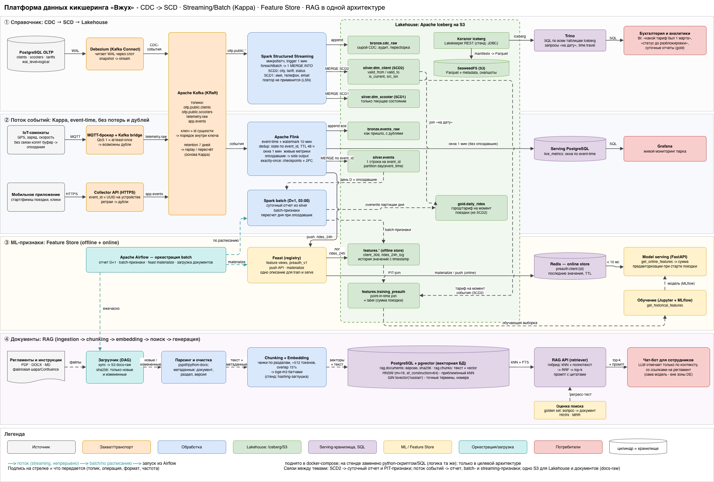

# Отчёт по практической №2

> Вариант 5 — все четыре темы (CDC→SCD, Streaming vs Batch, RAG, Feature Store) в одной архитектуре.
> Предметная область — вымышленный кикшеринг-сервис «Вжух».

---

## 1. Вариант и задача

| Поле | Значение |
|---|---|
| ФИО (как в VK Education) | Афанасьева Арина Владимировна |
| Тема | 5 — все темы в одной архитектуре (1 CDC→SCD→Lakehouse + 2 Streaming vs Batch + 3 RAG + 4 Feature Store) |
| Состав решения | PostgreSQL (OLTP) → Debezium → Kafka → Spark Structured Streaming → Iceberg (SCD2/SCD1); IoT/приложение → Kafka → Flink (event-time, dedup) → Iceberg + live-метрики → Grafana; Spark batch D+1 → gold-отчёт и batch-признаки; Feast + Iceberg (offline) + Redis (online) → model serving; документы → S3 → парсинг → chunking → embedding → pgvector (HNSW + GIN) → гибридный поиск → LLM; Trino — SQL над Lakehouse; Airflow — оркестрация; SeaweedFS — S3 |
| Данные, объём | Справочник: 7 клиентов (12 версий в SCD2), 20 самокатов, 37 CDC-сообщений. Поток: 3918 сообщений за 50 дней (3720 уникальных, 198 дублей, 272 опоздания на 1–6 ч), 744 поездки. Документы: 5 регламентов → 15 чанков. Признаки: 357 снимков `client_30d`, 744 строки обучающей выборки. Объём учебный — важна корректность, а не размер |

**Задача бизнеса одним абзацем.** У сервиса есть справочник клиентов и самокатов, который постоянно меняется (переезды, смена тарифа, блокировки). Бухгалтерии нужна история «на дату», а ходить SELECT-ами в боевую БД нельзя. Самокаты и приложение шлют события с дублями и опозданиями: нужны точный суточный отчёт и живой мониторинг. Поддержка и механики тонут в регламентах — нужен поиск-ответ по документам. А при старте поездки модель должна посчитать сумму предавторизации на карте, причём признаки при обучении и в проде должны быть одинаковыми.

## 2. Источники и способы сбора

| Источник | Тип | Способ сбора | Почему так |
|---|---|---|---|
| PostgreSQL OLTP: `clients`, `scooters`, `tariffs` | CDC | Debezium (Kafka Connect), плагин `pgoutput`, replication slot, `snapshot.mode=initial` → топики `oltp.public.*` | Читаем WAL, а не таблицы: нулевая нагрузка SELECT-ами, ловим каждое изменение (включая промежуточные и DELETE), есть порядок по LSN. `REPLICA IDENTITY FULL` даёт полный образ `before` — по нему потребитель понимает, *какой* атрибут поменялся (SCD2 или SCD1) |
| IoT-самокаты (GPS, заряд, скорость) | поток | MQTT (QoS 1) → Kafka bridge → `telemetry.raw` | Самокаты в мобильной сети: MQTT лёгкий и держит обрывы связи. QoS 1 = at-least-once → дубли неизбежны, поэтому `event_id` генерирует устройство |
| Мобильное приложение (старт/финиш поездки, клики) | поток | HTTPS Collector API (батчи с ретраями) → `app.events`, ключ `scooter_id` | Приложение копит события офлайн и досылает → опоздания; ретраи → дубли. Ключ даёт порядок событий одного самоката в партиции |
| Регламенты и инструкции (PDF, DOCX, MD) | документы | Airflow-DAG синхронизирует шару/Confluence в S3-бакет `docs-raw`, sha256 → обрабатываются только новые/изменённые | Документы меняются редко — потоковая обработка не нужна, достаточно batch раз в час. Хэш избавляет от переэмбеддинга всего корпуса |
| Признаки для ML | производные | не отдельный источник: batch-признаки из `silver.events` (Spark D+1), streaming-признаки из Flink (push), тариф — из SCD2 | Признаки считаются из тех же очищенных данных, что и отчёты, — один источник правды |

## 3. Архитектура (draw.io)



Исходник: [`architecture.drawio`](architecture.drawio). Схема разбита на 4 полосы (по темам), колонки идут слева направо по пути данных: источник → захват/транспорт → обработка → Lakehouse → serving → потребители. Внизу легенда цветов, типов стрелок (сплошная — поток, пунктир — batch) и пометок статуса на стенде (★ поднято / ☆ заменено скриптом / ○ только на схеме). Каждая стрелка подписана: что именно по ней идёт.

Из пройденного на схеме: **CDC (Debezium/Kafka), SCD2 + SCD1, Lakehouse (Iceberg/S3/Trino), Kappa + event-time + watermark, RAG (5 стадий), векторная БД (HNSW, гибридный поиск), Feature Store (offline/online, PIT)**.

### 3.1 ① Справочник: CDC → SCD → Lakehouse

**Почему CDC через Debezium → Kafka → потребитель.** Альтернатива — периодический `SELECT ... WHERE updated_at > X`: он грузит источник, пропускает промежуточные состояния (две смены статуса между запусками превратятся в одну) и не видит DELETE. Debezium читает WAL через логический слот, отдаёт `before/after/op/lsn`. Kafka развязывает источник и потребителей: при падении Spark источник не страдает, а события ждут в топике (retention 7 дней). Минус, который надо помнить: слот держит WAL, пока потребитель не прочитал, поэтому нужен мониторинг лага слота.

**Тип SCD — гибрид, по атрибутам:**

| Сущность / атрибут | Тип | Почему |
|---|---|---|
| `client`: `city`, `tariff_code`, `status` | **SCD2** | от них зависят деньги и отчёты: «какой тариф был на 1 марта», «статус до разблокировки». Новая строка с `valid_from/valid_to/is_current` |
| `client`: `full_name`, `phone`, `email` | **SCD1** | исправления и контакты: история аналитике не нужна, а новая версия на каждую опечатку раздула бы таблицу. Перезапись текущей версии |
| `scooter` целиком | **SCD1** | статус самоката меняется сотни раз в день — SCD2 взорвался бы. История состояний самоката уже есть в потоке событий (②) |
| SCD Type 6 | не выбран | Type 6 (2+3+1: и история, и «текущее значение» в каждой строке) удобен, если аналитикам часто нужно «тариф тогда и тариф сейчас» рядом. Здесь это решается join'ом с `is_current`, держать лишний столбец, который переписывается во всех версиях, незачем |

**Обработка: микробатч (Spark Structured Streaming), а не непрерывный стриминг.** SCD2 — это `MERGE INTO` в Iceberg, а каждый коммит Iceberg = новый снапшот и файлы. Непрерывная запись по одной строке дала бы тысячи мелких файлов и снапшотов. Бизнесу история нужна «на дату», задержка в минуту не важна. Поэтому: `foreachBatch`, trigger 1 мин, на микробатч **один атомарный MERGE**. Внутри батча события сортируются по LSN; несколько изменений одного ключа в батче дают цепочку версий. Защита от повторной доставки — колонка `updated_lsn`: события с LSN ≤ уже применённого пропускаются (проверено на стенде, см. раздел 4).

**Хранение:** Iceberg на S3 (SeaweedFS), каталог — Lakekeeper (REST) в целевой схеме, на стенде JDBC-каталог в PostgreSQL (как в лабе 4). Слои: `bronze.cdc_raw` (сырые события — аудит и возможность пересобрать silver), `silver.dim_client`, `silver.dim_scooter`. Читает Trino: запросы «на дату», плюс time travel Iceberg.

### 3.2 ② Поток событий: Streaming + Batch без потерь и дублей

**Kappa, а не Lambda.** В Lambda два кода (batch-слой и speed-слой) считают одно и то же по-разному — цифры в мониторинге и в отчёте расходятся, и поддерживать надо оба. Здесь одна потоковая логика (Flink) пишет очищенные события в `silver.events`; суточный отчёт — это не отдельная обработка сырья, а SQL поверх того же silver. Если логику поменяли — перечитываем Kafka (retention 7 дней) или bronze. Честно: batch-шаг (Spark D+1) в схеме есть, но он работает поверх результата потока, а не дублирует его, — поэтому это Kappa с batch-витринами, а не Lambda.

**Event-time, а не processing-time.** Отчёт «сколько поездок было 4 марта» должен считать по времени, когда поездка *произошла*, а не когда событие доехало. Самокат без связи отдаёт буфер через 1–6 часов — в processing-time эти поездки попали бы не в тот день.

**Поздние события — варианты и что выбрано:**

1. **Watermark + окна** (Flink): watermark = min по партициям(max event_time) − 10 мин. Для живого мониторинга события старше watermark отбрасываются из окон → дашборд не «дёргается» задним числом.
2. **Side output**: опоздавшие не теряются — они всё равно пишутся в `silver.events` (флаг `late_for_live` в bronze).
3. **Пересчёт партиции**: суточный отчёт строится в D+1 03:00 из silver (к этому моменту почти всё доехало). Если событие пришло ещё позже — Spark перезаписывает партицию дня (`overwrite`), это идемпотентно.
4. Отвергнуто: огромный allowed lateness в стриминге (state растёт, дашборд неделями меняет прошлое) и processing-time (неверные дни).

**Дубли — варианты и что выбрано:**

1. `event_id` (UUID) генерируется **на устройстве** — у повторной отправки тот же id.
2. Дедупликация в потоке: keyed state по `event_id` с TTL 48 ч → живые метрики без задвоений.
3. Идемпотентная запись: `MERGE INTO silver.events ... WHEN NOT MATCHED THEN INSERT` по `event_id` — даже если поток перезапустился и state потерян, второй раз строка не вставится.
4. Exactly-once Flink: checkpoints + двухфазный коммит Iceberg sink; offsets Kafka фиксируются вместе с checkpoint.
5. Отвергнуто: «дедуп только в отчёте через `DISTINCT`» — каждый потребитель должен помнить про дубли, рано или поздно кто-то забудет.

**Движок:** Flink для потока (настоящий per-event, event-time и state — его сильная сторона, задержка секунды для мониторинга); Spark — для микробатч-MERGE в справочнике и batch D+1 (большие пересчёты, MERGE в Iceberg — сильная сторона Spark). **Куда:** bronze/silver/gold в Iceberg, живые метрики — в serving-PostgreSQL (Grafana читает быстро и маленькие окна).

### 3.3 ③ Feature Store

Модель: **сумма предавторизации** при старте поездки (сколько заблокировать на карте). Признаки: `rides_30d`, `avg_amount_30d` (batch), `rides_24h` (streaming), `tariff` на момент поездки (из SCD2).

- **Offline vs online — зачем оба.** Offline store (Iceberg `features.*`) хранит *историю* значений признаков с timestamp — для обучения нужно «каким был признак в момент каждой прошлой поездки». Online store (Redis) хранит только *последнее* значение по ключу — инференс при старте поездки должен ответить за миллисекунды, сканировать Lakehouse нельзя. Связаны через Feast: `materialize` переносит последние значения offline → online, `push` пишет streaming-признак сразу в оба.
- **Consistency и point-in-time correctness.** Одно описание признаков (Feast feature views) для train и serve — нет «в ноутбуке посчитали так, а в проде иначе». При сборке обучающей выборки каждая строка (поездка в момент `event_ts`) получает значения признаков с `feature_ts ≤ event_ts` (as-of join), тариф — из версии SCD2, действовавшей в `event_ts`. Иначе — утечка будущего. На стенде это видно цифрой: если взять «текущий» тариф вместо исторического, **34 строки из 670** получают неверный тариф.
- **Batch vs streaming признаки.** `avg_amount_30d`, `rides_30d` меняются медленно — раз в сутки Spark (дёшево). `rides_24h` («клиент только что накатал 7 поездок») устаревает за минуты — Flink пушит сразу. Тариф — из CDC/SCD2.
- **Как признаки попадают в модель.** Обучение: `get_historical_features(entity_df)` → PIT-join в offline → обучающая выборка → MLflow. Инференс: приложение → model serving → `get_online_features(client_id)` из Redis → предсказание.
- **Где хранятся:** offline — Iceberg на S3 (`features.client_30d`, `features.rides_24h_log`, `features.training_preauth`); online — Redis (`preauth:client:{id}`, TTL); реестр Feast — PostgreSQL.

### 3.4 ④ RAG

| Стадия | Что происходит | Решение |
|---|---|---|
| 1. Ingestion | синк файлов в S3 `docs-raw`, sha256, версия документа | новые/изменённые только; удалённый документ удаляется из индекса вместе с чанками |
| 2. Chunking | парсинг (pypdf / python-docx / unstructured), очистка колонтитулов, разбиение **по разделам**, длинные — окном ~512 токенов с overlap 15% | чанк = смысловой кусок регламента, раздел сохраняется → можно цитировать |
| 3. Embedding | батчем через сервис эмбеддингов (bge-m3, мультиязычная, 1024d) | одна и та же модель для документов и вопросов; при смене модели — полная переиндексация |
| 4. Векторный поиск | pgvector: HNSW (`m=16, ef_construction=64`, cosine) + GIN по `tsvector('russian')` → гибрид через RRF | см. ниже |
| 5. Генерация | промпт «ответь только по контексту, укажи источники» + top-k чанков → LLM | сама модель — не зона DE |

- **Векторная БД и индекс.** pgvector в PostgreSQL: корпус — тысячи документов (сотни тысяч чанков), отдельный кластер Milvus/Qdrant пока избыточен, а в Postgres вектор, текст, метаданные и полнотекст лежат в одной строке и фильтруются одним SQL. HNSW, а не IVFFlat: не требует обучения на данных, лучше recall/скорость, нормально переносит вставки (документы обновляются).
- **Гибридный поиск — зачем.** Вектор хорошо ловит перефразы («упал и травмировался» → раздел про ДТП), но плохо — точные термины, номера приказов, суммы. Полнотекст наоборот. RRF складывает *ранги*, не сводя несравнимые шкалы cosine и ts_rank.
- **Оценка качества поиска.** Golden set: вопрос → правильный документ (на стенде 12 вопросов). Метрики Hit@k, MRR@k (в проде ещё nDCG и оценка ответа — faithfulness/answer relevancy, например Ragas). Прогон на каждый выпуск (смена chunking, модели, параметров HNSW) как регресс-тест.
- **Роль data engineer.** На мне: сбор и синк документов, парсинг, очистка, чанкинг, метаданные и версии, эмбеддинг-пайплайн, индексы, инкрементальность, права доступа к документам, мониторинг свежести, golden set и метрики поиска. Не на мне: выбор и дообучение LLM, промпт-инжиниринг ответа, UI чат-бота.

### 3.5 Как темы связаны (почему это одна архитектура, а не четыре)

- **SCD2 → отчёт:** суточный отчёт делает point-in-time join поездок с `dim_client` — выручка относится к городу/тарифу, какой был *в момент поездки* (клиент 2 переехал 3 марта — его поездки 4 марта уже в Казани).
- **SCD2 → ML:** тариф как признак берётся той версии, которая действовала в момент события.
- **Поток → ML:** из одного и того же `silver.events` считаются и отчёт, и batch-признаки; Flink пушит streaming-признаки.
- **Общая инфраструктура:** одна Kafka, одно S3 (и Lakehouse, и `docs-raw`), один Airflow, один PostgreSQL под каталог/pgvector/реестр Feast.

## 4. Docker — что поднялось (честно)

`docker compose up -d` поднимает облегчённый стенд (~3,6 ГБ RAM): тяжёлые Flink, Spark, Airflow, Feast-сервер не поднимала — их логика воспроизведена python-скриптами и SQL в Trino. Это осознанно, чтобы ноутбук «не взорвался».

| Блок на схеме | Статус | Чем реализовано на стенде |
|---|---|---|
| PostgreSQL OLTP | реализовано | `pg-oltp` (wal_level=logical), `sql/oltp/*.sql` |
| Debezium | реализовано | `debezium` (Kafka Connect 2.7), `scripts/debezium-connector.json` |
| Kafka (KRaft) + Kafka UI | реализовано | `kafka`, `kafka-ui` (http://localhost:8081) |
| Spark Structured Streaming (CDC → SCD) | заменено | `pipelines/cdc_to_scd2.py`: микробатч из Kafka → один `MERGE` в Iceberg через Trino, коммит offsets после записи |
| Iceberg bronze/silver/gold/features | реализовано | таблицы в `lakehouse.*`, `sql/lakehouse/*.sql` |
| Каталог Iceberg | частично | JDBC-каталог в `pg-meta` вместо Lakekeeper (REST) |
| S3 | реализовано | SeaweedFS (MinIO перестал публиковать образы — как в лабе 4) |
| Trino | реализовано | `trino` (http://localhost:8080) |
| IoT / MQTT / приложение / Collector | нет | заменены генератором `pipelines/events_generator.py` (дубли 5%, опоздания 8%) |
| Flink | заменено | `pipelines/events_to_iceberg.py`: per-partition watermark, dedup state с TTL, side output, MERGE по event_id |
| Spark batch D+1 | заменено | SQL в Trino: `03_gold_daily.sql`, `05_features.sql` |
| Serving PostgreSQL (live-метрики) | реализовано | схема `serving` в `pg-meta` |
| Grafana | нет | метрики проверены SQL-запросом |
| Feast | частично | определения в `features/feature_repo/` (не запускались); PIT-join — SQL, materialize — `features/push_online.py` |
| Redis (online store) | реализовано | `redis` |
| Model serving / обучение / MLflow | нет | вне объёма; обучающая выборка и онлайн-признаки готовы |
| Airflow | нет | шаги запускает `scripts/run_all.sh` |
| RAG: загрузка, парсинг, chunking | заменено | `rag/ingest.py` (S3 `docs-raw`, sha256, чанки по разделам); только MD, без PDF/DOCX |
| Embedding-модель | заглушка | `rag/embed.py`: feature hashing 384d вместо bge-m3 — чтобы не качать гигабайты весов. Остальной пайплайн настоящий |
| pgvector (HNSW + GIN) | реализовано | `pg-meta` (образ `pgvector/pgvector:pg16`), `sql/meta/02_rag.sql` |
| RAG API (гибрид, RRF) + оценка | реализовано (скрипт) | `rag/search.py` |
| LLM | нет | собирается готовый промпт с контекстом; генерация — вне зоны DE |

### Как запускалось

```bash
docker compose up -d                                   # 8 сервисов + create-buckets
python3 -m venv .venv && .venv/bin/pip install -r requirements.txt

# Iceberg-таблицы
docker compose exec -T trino trino -f /dev/stdin < sql/lakehouse/01_ddl.sql

# ① CDC: регистрируем коннектор -> initial snapshot -> SCD
curl -X POST -H 'Content-Type: application/json' \
     --data @scripts/debezium-connector.json http://localhost:8083/connectors
(cd pipelines && ../.venv/bin/python cdc_to_scd2.py)
docker compose exec -T pg-oltp psql -U app -d vzhuh < sql/oltp/02_changes.sql   # жизнь справочника
(cd pipelines && ../.venv/bin/python cdc_to_scd2.py)
docker compose exec -T trino trino -f /dev/stdin < sql/lakehouse/02_history_queries.sql

# ② поток: генератор (400 msg/s) и потребитель параллельно
(cd pipelines && ../.venv/bin/python events_to_iceberg.py) &
(cd pipelines && ../.venv/bin/python events_generator.py 400)
docker compose exec -T trino trino -f /dev/stdin < sql/lakehouse/03_gold_daily.sql
docker compose exec -T trino trino -f /dev/stdin < sql/lakehouse/04_quality_checks.sql

# ③ признаки
docker compose exec -T trino trino -f /dev/stdin < sql/lakehouse/05_features.sql
.venv/bin/python features/push_online.py

# ④ RAG
cd rag && ../.venv/bin/python ingest.py && ../.venv/bin/python search.py
```

Всё то же одной командой: `bash scripts/run_all.sh`.

### `docker ps`

```
NAMES                      IMAGE                                  STATUS                   PORTS
pr2-platform-trino-1       trinodb/trino:476                      Up 8 minutes (healthy)   0.0.0.0:8080->8080/tcp
pr2-platform-debezium-1    quay.io/debezium/connect:2.7.3.Final   Up 8 minutes (healthy)   0.0.0.0:8083->8083/tcp
pr2-platform-kafka-ui-1    provectuslabs/kafka-ui:v0.7.2          Up 8 minutes             0.0.0.0:8081->8080/tcp
pr2-platform-pg-oltp-1     postgres:16-alpine                     Up 8 minutes (healthy)   0.0.0.0:5433->5432/tcp
pr2-platform-redis-1       redis:7-alpine                         Up 8 minutes (healthy)   0.0.0.0:6379->6379/tcp
pr2-platform-pg-meta-1     pgvector/pgvector:pg16                 Up 8 minutes (healthy)   0.0.0.0:5434->5432/tcp
pr2-platform-kafka-1       apache/kafka:3.8.0                     Up 8 minutes (healthy)   0.0.0.0:9094->9094/tcp
pr2-platform-seaweedfs-1   chrislusf/seaweedfs:3.80               Up 8 minutes (healthy)   0.0.0.0:8333->8333/tcp, 0.0.0.0:8888->8888/tcp
```

`create-buckets` — одноразовый контейнер, `Exited (0)` (создал бакеты `warehouse` и `docs-raw`). Память (`docker stats`): Trino 2,0 ГБ, Kafka 0,54, Debezium 0,47, SeaweedFS 0,32, Kafka UI 0,24, Postgres×2 и Redis — по 10–35 МБ. Полные выводы — в `docs/`.

### Что получилось (выводы скриптов)

**① Debezium-коннектор и CDC → SCD**

```
{"name":"vzhuh-oltp","connector":{"state":"RUNNING"},"tasks":[{"id":0,"state":"RUNNING"}]}
batch 1: msgs=26 clients={'versions_inserted': 6} scooters_upserted=20                         # initial snapshot
batch 1: msgs=11 clients={'closed': 6, 'versions_inserted': 6, 'scd1_overwrites': 1} scooters_upserted=2   # изменения
```

История клиентов 1 и 3 (`02_history_queries.sql`, время UTC):

```
 client_id |    phone     | tariff | status  |   valid_from      |    valid_to       | is_current
         1 | +79000000001 | base   | active  | 2026-01-10 07:00  | 2026-02-15 09:00  | false
         1 | +79990000001 | pro    | active  | 2026-02-15 09:00  | 9999-12-31 00:00  | true     <- телефон перезаписан (SCD1), без новой версии
         3 | +79000000003 | pro    | active  | 2026-01-10 07:00  | 2026-03-10 11:00  | false
         3 | +79000000003 | pro    | blocked | 2026-03-10 11:00  | 2026-03-20 08:00  | false
         3 | +79000000003 | pro    | active  | 2026-03-20 08:00  | 9999-12-31 00:00  | true
«Какой статус был у клиента 3 до разблокировки?» -> blocked
Удалённый клиент 6: текущей версии нет, история осталась.
```

Каждый микробатч — один снапшот Iceberg (`dim_client$snapshots`: append → overwrite → overwrite), то есть запись атомарна.

**Проверка идемпотентности:** сбросила offsets группы `scd-writer` в начало и перечитала все 37 сообщений — `skipped_replay: 14`, в таблице по-прежнему 12 версий и 6 текущих. Повторная доставка не задваивает историю. (В `bronze.cdc_raw` replay дописался — это ожидаемо: bronze — сырой append-лог.)

**② Поток событий**

```
generator: unique events=3720 sent=3918 duplicates=198 late(1-6h)=272
loader:    received=3918 dup_in_stream=198 late_side_output=67 silver_inserted=3720

 bronze_rows | bronze_unique_ids | silver_rows | silver_duplicates | late_for_live
        3918 |              3720 |        3720 |                 0 |            69
live_metrics: 2188 + 731 + 734 = 3653 = 3720 − 67 опоздавших (в мониторинг не попали, в отчёт — попали)
```

Почему опоздавших 67, а `late_for_live` = 69: флаг в bronze ставится до дедупликации, а bronze хранит и дубли — 2 опоздавших события пришли дважды. Уникальных опоздавших — 67.

Ни одного потерянного и ни одного задвоенного события в silver; суточный отчёт `gold.daily_rides` — 254 строки (день × город × тариф).

Честное наблюдение: при первом прогоне я сначала отправила все события в Kafka, а потом читала бэклогом — потребитель выкачивает партиции по очереди, и watermark (минимум по всем 6 партициям) долго не определён, поэтому опоздавших отметилось всего 8. Это реальный эффект догона/backfill (во Flink для этого есть watermark alignment и idleness). В живом режиме (генератор и потребитель параллельно) — 67. На данные в silver это не влияет, только на то, что увидел бы живой дашборд.

**③ Признаки**

```
features.client_30d: 357 строк;  features.training_preauth: 744 строки
Клиент 1, тариф в обучающей выборке:  15.02 10:36 -> base,  15.02 21:24 -> pro  (смена тарифа 15.02 12:00)
Утечка при наивном join с текущим тарифом: 34 из 670 строк получили бы неверный тариф
  (670, а не 744: у удалённого клиента 6 нет текущей версии — его 74 поездки наивный join просто потерял бы, ещё одна ошибка такого подхода)
materialized 6 clients to Redis
online/offline consistency: 7 clients checked, mismatches=0
online: {'f_rides_30d': '81', 'f_avg_amount_30d': '105.86', 'f_tariff': 'pro', 'f_rides_24h': '7'}
```

**④ RAG**

```
ingest: {'new': 5, 'changed': 0, 'unchanged': 0, 'chunks': 15}
ingest: {'new': 0, 'changed': 0, 'unchanged': 5, 'chunks': 0}     <- повторный запуск: sha256 не изменились
golden set: 12 вопросов
  vector  Hit@3=1.00  MRR@3=0.88
  fts     Hit@3=1.00  MRR@3=0.92
  hybrid  Hit@3=1.00  MRR@3=1.00
```

Гибрид ставит нужный документ первым во всех 12 вопросах. `EXPLAIN` векторного запроса показывает `Index Scan using chunks_hnsw ... Order By: (embedding <=> $0)` — kNN идёт через HNSW-индекс. Честно: корпус маленький (15 чанков), выигрыш индекса по скорости здесь не измерить, и «вектор» — hashing-заглушка, поэтому абсолютные цифры не про качество настоящей модели, а про то, что пайплайн поиска и оценки работает.

## 5. Описание пути данных

| Шаг | Для чего | Результат |
|---|---|---|
| 1. Приложение меняет клиента в PostgreSQL | живой справочник | запись в WAL |
| 2. Debezium читает WAL через слот | захват изменений без нагрузки на источник | JSON `before/after/op/lsn` в `oltp.public.clients` |
| 3. Spark SS (стенд: `cdc_to_scd2.py`) — микробатч | материализовать историю | `bronze.cdc_raw` + один MERGE в `silver.dim_client` (SCD2/SCD1) |
| 4. Trino запрос «на дату» | ответ бухгалтерии | тариф/статус клиента на 1 марта без похода в OLTP |
| 5. Самокаты и приложение шлют события | телеметрия и поездки | Kafka `telemetry.raw`, `app.events` (с дублями и опозданиями) |
| 6. Flink (стенд: `events_to_iceberg.py`) | очистка потока | bronze как есть; silver — 1 строка на `event_id`; live-окна по event-time |
| 7. Grafana | живой мониторинг | поездки/телеметрия за минуты |
| 8. Spark batch D+1 | точный отчёт | `gold.daily_rides` с городом/тарифом на момент поездки (PIT-join SCD2), пересчёт партиций при опоздавших |
| 9. Spark batch + Flink push → Feast | признаки | offline: `features.*` в Iceberg; online: Redis |
| 10. PIT-join | обучение без утечки | `features.training_preauth` → обучение модели |
| 11. Старт поездки → model serving → Redis | инференс | сумма предавторизации за миллисекунды, признаки те же, что при обучении |
| 12. Регламенты → S3 → парсинг → chunking → embedding | подготовка знаний | чанки с векторами и tsvector в pgvector |
| 13. Вопрос сотрудника → гибридный поиск → LLM | ответ по документам | ответ со ссылками на раздел регламента |

## 6. Выводы

- Самое ценное открытие — темы курса не независимы. SCD2 нужна не только бухгалтерии: без неё нельзя честно собрать ни суточный отчёт по городам, ни обучающую выборку — на стенде наивный join с текущим справочником испортил 34 строки из 670.
- «Без потерь и дублей» обеспечивается не одним механизмом, а цепочкой: id на устройстве → дедуп в state → идемпотентный MERGE → коммит offsets после записи. Любое звено по отдельности не спасает: state теряется при рестарте, а без id на устройстве MERGE не по чему делать.
- Тип SCD выбирается по атрибуту, а не по таблице: тариф — SCD2, телефон — SCD1, самокат — SCD1, потому что его история уже есть в событиях.
- Watermark ведёт себя по-разному в живом потоке и при догоне бэклога — увидела это на своих данных, а не только на лекции.
- В RAG основная работа — данные (парсинг, чанки, версии, инкрементальность, оценка), а не модель. Гибридный поиск даже на маленьком корпусе стабильнее, чем вектор или полнотекст по отдельности.
- Что бы сделала дальше: поднять настоящий Flink и Lakekeeper в отдельном профиле compose, подключить настоящую эмбеддинг-модель и Grafana.

## Мой любимый десерт

Медовик 🍯 — тонкие коржи, сметанный крем, и чтобы постоял ночь в холодильнике. Он немного похож на Lakehouse: много слоёв, и каждый пропитан предыдущим.
